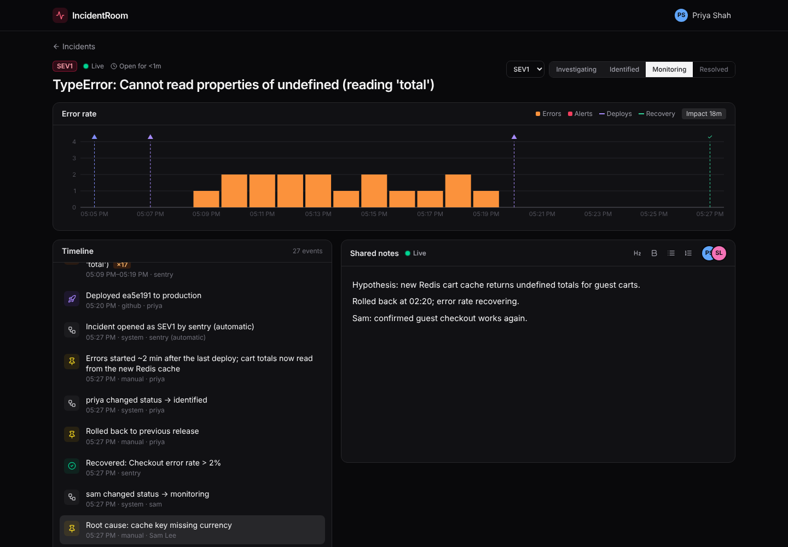
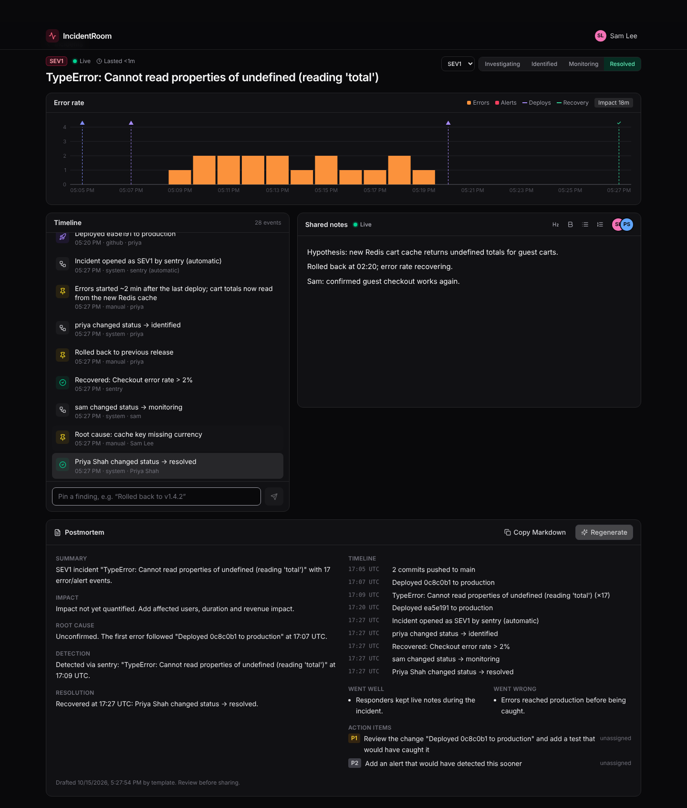
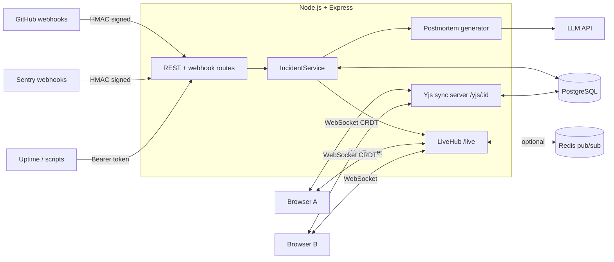

# IncidentRoom

**A real-time war room for production outages.** Alerts from GitHub, Sentry and uptime monitors build a live timeline automatically, the whole team writes notes together with live cursors, an error-rate chart shows which deploy broke things, and AI drafts the blameless postmortem when it's over.



## Why

When production breaks, teams scramble across Slack threads, dashboards and docs. Afterwards someone spends hours piecing together *what happened when* to write the postmortem. IncidentRoom puts it in one place, as it happens:

1. **An alert fires.** A Sentry error or failed deploy webhook **opens an incident automatically** and pulls in the deploys and pushes from the previous hour ("what changed?").
2. **Responders join the room.** Everyone edits the same notes in real time (Google Docs-style cursors), pins key findings to the timeline and moves the status from *investigating* to *resolved*.
3. **The chart answers "was it the deploy?"** Errors per minute are drawn against deploy and recovery markers.
4. **One click drafts the postmortem.** An LLM reads the timeline and notes and returns a structured, blameless postmortem (summary, root cause, timeline, action items) that you can copy as Markdown.

## Features

| | |
|---|---|
| **Real-time collaborative notes** | CRDT-based editing (Yjs + TipTap) over WebSockets, with live cursors, presence avatars and offline-tolerant merging. Documents persist to Postgres. |
| **Webhook ingestion** | GitHub (`deployment_status`, `workflow_run`, `push`), Sentry (`event_alert`, `issue`, `metric_alert`) and a generic token-auth endpoint. HMAC-SHA256 signature verification with constant-time comparison. |
| **Idempotent and ordered** | Provider retries are de-duplicated with a unique `(source, external_id)` index. The timeline orders by when events *happened*, not when they arrived. |
| **Smart routing** | Events go to the named incident, else the open one. A new alert opens an incident automatically, and deploys with no incident are held so the next incident can pull them in. |
| **Live everything** | Timeline entries, status changes and new incidents are pushed to every open browser. Optional Redis pub/sub lets you run several server instances. |
| **Error-rate visualization** | Adaptive time buckets (1m to 6h), stacked errors and alerts, and deploy and recovery markers. |
| **AI postmortems** | LLM with JSON-schema structured output (validated again with Zod), a prompt-injection-aware system prompt and refusal handling. Falls back to a deterministic template without an API key. |
| **Production-ready** | Typed end to end (TypeScript + Zod), migrations, graceful shutdown that flushes unsaved notes, health checks, Docker, CI, and Terraform-managed AWS deploys. |



## Architecture



**Key design decisions**

- **CRDTs instead of locking or last-write-wins.** Two people typing in the same sentence both keep their edits, and reconnecting clients merge cleanly. The sync server is written directly on `y-protocols`. It buffers messages while a document loads from Postgres, debounces saves, and does a final save when the last person leaves.
- **Normalize at the edge.** Each provider payload is checked with a Zod schema and converted into one `NormalizedEvent` shape, so the rest of the system never touches provider-specific JSON. Adding PagerDuty or Datadog is one function.
- **Two sockets, two jobs.** `/yjs/:id` carries binary CRDT updates for the notes, and `/live` carries small JSON pushes for everything else. The live hub can sit behind Redis pub/sub without changing callers.
- **The AI is optional and verifiable.** Prompt building is a pure function with unit tests. The LLM call is tested against a fake HTTP layer, so CI never needs an API key.

## Tech stack

**Frontend:** React 18, TypeScript, Vite, Tailwind CSS v4, TipTap + Yjs, Recharts, React Router
**Backend:** Node.js 22, Express 5, `ws`, Yjs / y-protocols, PostgreSQL (`pg`), Redis (`ioredis`), Zod
**AI:** LLM API with structured outputs
**Infra:** AWS (EC2, SSM, IAM, Budgets) with Terraform, Caddy, Docker Compose, GitHub Actions CI/CD with OIDC, Render blueprint
**Testing:** Vitest, Supertest, Playwright (end-to-end, multi-user)

## Run it locally

**With Docker** (Postgres and Redis included):

```bash
docker compose up --build
# open http://localhost:4000
```

**Without Docker** (needs Node 22 and a Postgres database):

```bash
npm install
cp .env.example .env          # set DATABASE_URL
npm run dev                   # API on :4000, web on :5173
```

**Watch an outage unfold:** with the app open, run this in another terminal:

```bash
npm run simulate
```

The simulator plays a realistic incident: a push, a bad deploy, an error spike that auto-opens an incident, responders' findings, a rollback and recovery. Open the room in two browser windows to see collaboration live.

## Deploy

### AWS (Terraform)

Infrastructure as code in [`infra/aws`](infra/aws): an EC2 instance running the stack with Docker Compose, Caddy for automatic HTTPS, secrets in SSM Parameter Store, no SSH (Session Manager only), a budget alert, and **GitHub Actions auto-deploy over OIDC** (no AWS keys stored in GitHub).

```bash
cd infra/aws
cp terraform.tfvars.example terraform.tfvars   # set alert_email
terraform init && terraform apply              # prints your https:// URL
```

Step-by-step guide for first-time AWS users: **[docs/deploy-aws.md](docs/deploy-aws.md)**.

### Render (free, simplest)

On [Render](https://render.com): **New → Blueprint**, then select the repo. `render.yaml` creates the web service and a Postgres database. Render's free Postgres expires after 30 days; for a lasting demo point `DATABASE_URL` at a free [Neon](https://neon.tech) database (add `?sslmode=require`).

### Connect real webhooks

| Source | URL | Setup |
|---|---|---|
| GitHub | `https://<app>/api/webhooks/github` | Repo → Settings → Webhooks. Content type `application/json`, secret = `GITHUB_WEBHOOK_SECRET`, events: *Deployment statuses, Workflow runs, Pushes*. |
| Sentry | `https://<app>/api/webhooks/sentry` | Settings → Developer Settings → Internal Integration. Webhook URL as shown, enable *Issue* + *Alert rule action*, and copy the client secret to `SENTRY_WEBHOOK_SECRET`. |
| Anything else | `https://<app>/api/webhooks/ingest` | `POST` with `Authorization: Bearer $INGEST_TOKEN` and `{"kind":"alert","title":"Checkout down","id":"unique-id"}` |

Add `?incident=<id>` to any webhook URL to send events to a specific incident.

## Tests

```bash
npm test                                   # unit tests
TEST_DATABASE_URL=postgres://... npm test  # + API integration tests against Postgres
```

These cover signature verification (including tampered bodies), payload normalization for each provider, duplicate delivery handling, automatic incident creation with recent-change attachment, metrics bucketing, the LLM request shape and refusal handling, and CRDT-document-to-text extraction. CI runs everything against a real Postgres service.

## Roadmap

- Auth and team workspaces (currently anyone with the link can join, which suits a demo)
- Slack integration: post updates and open the room from `/incident`
- Similar past incidents via embeddings ("this looks like INC-42")
- Status page generated from the incident state

## API

| Method | Path | Description |
|---|---|---|
| `GET` | `/api/incidents` | List incidents with event counts |
| `POST` | `/api/incidents` | Declare `{ title, severity }` |
| `GET` | `/api/incidents/:id` | Incident + full timeline |
| `PATCH` | `/api/incidents/:id` | Update `status` / `severity` / `title` |
| `POST` | `/api/incidents/:id/events` | Pin a finding to the timeline |
| `GET` | `/api/incidents/:id/metrics` | Bucketed error rate + markers |
| `POST` | `/api/incidents/:id/postmortem` | Generate the postmortem |
| `WS` | `/live?incident=:id\|all` | JSON push of events and incident changes |
| `WS` | `/yjs/:id` | Yjs sync for collaborative notes |
