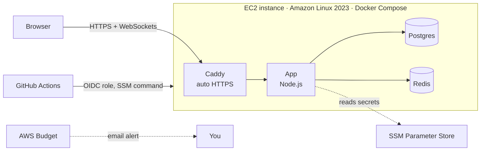

# Deploy IncidentRoom to AWS

One command creates everything; one command deletes it. Total time: about 20 minutes, most of it waiting.

## What gets created



| Resource | Why |
|---|---|
| EC2 `t3.micro` + Elastic IP | Runs the app, Postgres and Redis in Docker. Fixed IP so the URL never changes. |
| Caddy | Free HTTPS certificate (Let's Encrypt), auto-renewed, WebSocket-aware. |
| SSM Parameter Store | Encrypted secrets (DB password, webhook secrets, AI key), never in Git or user data. |
| IAM roles | Server can read only its own secrets. GitHub can only run the deploy command on this one server. |
| No SSH | Port 22 is closed. Shell access uses SSM Session Manager. |
| GitHub OIDC | Auto-deploy on every push to `main` without storing AWS keys in GitHub. |
| AWS Budget | Emails you at 80% of your monthly limit (default $15). |

**Cost:** about **$12–14/month** after free credits (t3.micro ~$7.60, 20 GB disk ~$1.60, public IPv4 ~$3.60). New AWS accounts get free credits; check [aws.amazon.com/free](https://aws.amazon.com/free). Run `terraform destroy` when you don't need it and it costs nothing.

## Step 1: Install the tools (once)

- **AWS account:** sign up at [aws.amazon.com](https://aws.amazon.com). Turn on MFA for the root user.
- **AWS CLI:** [install guide](https://docs.aws.amazon.com/cli/latest/userguide/getting-started-install.html)
- **Terraform:** [install guide](https://developer.hashicorp.com/terraform/install)
- **Session Manager plugin** (optional, for shell access): [install guide](https://docs.aws.amazon.com/systems-manager/latest/userguide/session-manager-working-with-install-plugin.html)

## Step 2: Give your computer AWS access

Don't use the root user day to day. In the AWS console:

1. **IAM → Users → Create user**, name it `terraform`.
2. Attach the **AdministratorAccess** policy (fine for a personal sandbox account).
3. Open the user → **Security credentials → Create access key → Command Line Interface**.
4. On your computer:

```bash
aws configure
# paste the access key + secret, region: us-east-1, output: json
aws sts get-caller-identity   # should print your account id
```

## Step 3: Deploy

```bash
cd infra/aws
cp terraform.tfvars.example terraform.tfvars
# edit terraform.tfvars: set alert_email (and ai_api_key if you have one)

terraform init
terraform apply        # review the plan, type "yes"
```

When it finishes it prints your URL, e.g. `https://3-91-20-7.sslip.io`.

**Wait 5–10 minutes.** The server installs Docker, builds the app and gets an HTTPS certificate. Then open the URL. AWS also emails you to **confirm the budget alert subscription**: click the link.

> If your AWS account already has a GitHub OIDC provider, add `create_github_oidc_provider = false` to `terraform.tfvars`.

## Step 4: Turn on auto-deploy from GitHub

```bash
terraform output github_actions_variables
```

In GitHub: **repo → Settings → Secrets and variables → Actions → Variables tab → New repository variable**. Add each one: `AWS_DEPLOY_ROLE_ARN`, `AWS_INSTANCE_ID`, `AWS_REGION`, `APP_URL`.

From now on, every push to `main` runs CI, then **Deploy to AWS** pulls the new code on the server, rebuilds and health-checks it. You can also run it by hand from the Actions tab.

## Step 5 (optional): Connect real GitHub webhooks

```bash
terraform output -raw github_webhook_secret
```

GitHub repo → **Settings → Webhooks → Add webhook**:
- Payload URL: `https://<your-url>/api/webhooks/github`
- Content type: `application/json`
- Secret: the value above
- Events: *Deployment statuses, Workflow runs, Pushes*

## Everyday commands

```bash
# Shell on the server (no SSH key needed)
aws ssm start-session --target $(terraform output -raw instance_id)

# On the server:
sudo docker compose -f /opt/incident-room/docker-compose.prod.yml logs -f app
sudo cat /var/log/incident-room-bootstrap.log     # first-boot log
sudo /usr/local/bin/incident-room-deploy          # manual redeploy
```

## Delete everything

```bash
cd infra/aws
terraform destroy
```

This removes the server **and its database**. Nothing keeps billing afterwards.

## Troubleshooting

| Symptom | Fix |
|---|---|
| URL doesn't load after 10 min | Open a shell and check `/var/log/incident-room-bootstrap.log`. |
| Browser warns about the certificate | Caddy is still getting it. Wait a minute and reload. |
| `EntityAlreadyExists` for the OIDC provider | Set `create_github_oidc_provider = false` and apply again. |
| Deploy workflow is skipped | The repository variables from Step 4 aren't set. |

## Scaling up later (talking points for interviews)

- Move Postgres to **RDS** for managed backups and failover.
- Run the app on **ECS Fargate** behind an **Application Load Balancer** with 2+ tasks. Redis pub/sub is already wired in, so live updates work across instances.
- Store Terraform state in **S3 with locking** for team use.
